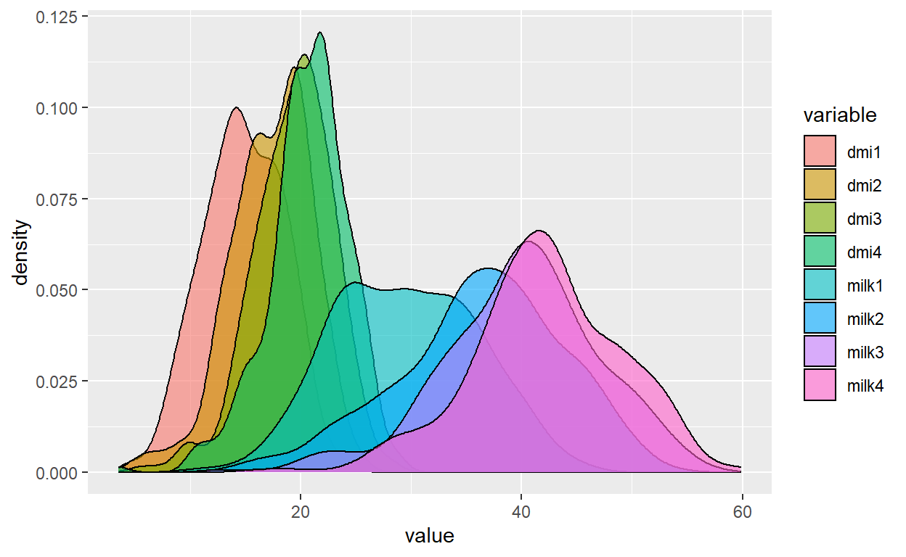
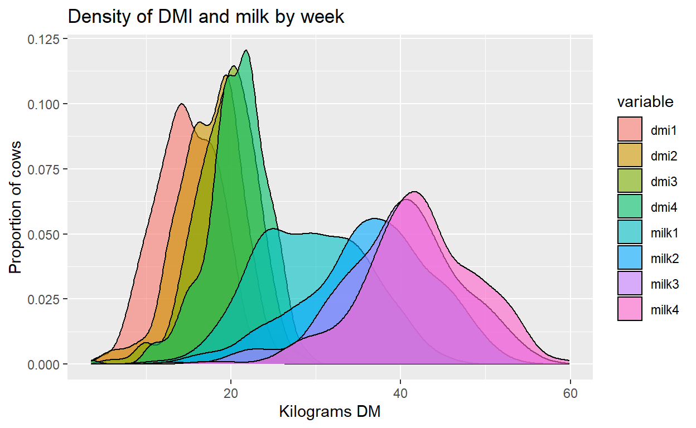
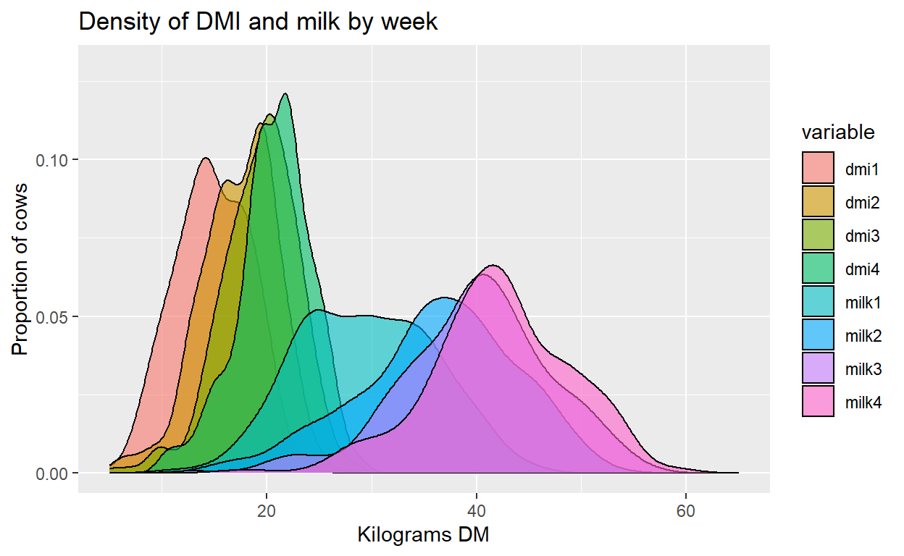

When working with variables that have repeated measurements on a regular interval it can be useful to visualize how the values change by measurement. Density plots are a great way of describing a variable and let you quickly visualize how the data is distributed.

In biology we usually assume the central limit theorem, that the sum of independent random variables tends towards a normal distribution. But understanding the distribution of a variable of interest, if it assumes a normal distribution, if there is skew, or if it could be better described by an alternate distribution shape can be important information.

------------------------------------------------------------------------

In this article I will demonstrate using a sample database how you can appropriately set up your data, then visualize the density plot on each level of a repeated variable and how you can easily overlay them using ggplot2 in R Studio. This provides an easy visual assessment of the shape and distribution of your data over time.

------------------------------------------------------------------------

## Setting up the data

The data I am using includes individual cow records with weekly measurements of milk yield and feed consumption (DMI as dry matter intake) in kilograms. Immediately after a cow gives birth her milk production and feed requirement quickly increase, but usually the energy demand for milk production exceeds the cows ability to consume enough feed in the first several weeks. Here we will examine and plot the distribution of milk and DMI for this cow group over the first 4 weeks of the lactation.

## Loading packages and data

For data manipulation I will use the tidyverse package

```r
library(tidyverse)
```

Next I load, then create a subset of my full dataset with just the measurements of the weeks of interest.

```r
load("lact2all.rda")
group1 <- select(lact2all, CowID, dmi1, dmi2, dmi3, dmi4, milk1, milk2, milk3, milk4) 
group1 %>% as_tibble() %>% head()
```

    # A tibble: 6 x 9
      CowID  dmi1  dmi2  dmi3  dmi4 milk1 milk2 milk3 milk4
      <dbl> <dbl> <dbl> <dbl> <dbl> <dbl> <dbl> <dbl> <dbl>
    1  1546 14.5   14.9 19.1   17.8  22.9  26.6  31.7  31.5
    2  1594 15.7   16.0 17.6   19.9  34.2  35    38.3  42.0
    3  1595 14.0   13.7  9.73  12.0  36.2  34.5  20.8  26.6
    4  1601 17.5   17.5 19.2   17.6  33.9  38.8  43    42.4
    5  1639  9.41  11.7 14.8   15.8  24.1  24.5  28.6  33.6
    6  1640 18.3   18.1 17.6   19.5  21.7  31.9  34.5  38.1

## Convert the data to longform with a single column for variable name and values

Using the melt function from the reshape package we can easily make this data set long by pivoting around the unique CowID as our id variable.

```r
library(reshape)
plotdata <- reshape::melt(group1, id="CowID"); 
plotdata %>% group_by(variable) %>% summarise(Cows = n_distinct(CowID))
```

    # A tibble: 8 x 2
      variable  Cows
      <fct>    <int>
    1 dmi1       316
    2 dmi2       316
    3 dmi3       316
    4 dmi4       316
    5 milk1      316
    6 milk2      316
    7 milk3      316
    8 milk4      316

## Building a density plot in ggplot2 and overlaying weeks

Loading the ggplot2 package we can build a density plot object using the variable column from our melted data set as the fill. Because we have multiple levels of the variable factor (milk1:milk4, dmi1:dmi4) this will create a separate density plot for each. We need to specify it as a density plot by adding geom_density to the plot object using `+ geom_density(alpha=x)`. The alpha number sets the opacity of the color fill of each density plot. Because we expect overlap it is smart to set this number low.

Remember, when adding elements to a ggplot2 object the `+` must be entered at the end of your line, not at the beginning of a new line.

```r
library(ggplot2)
Plot <- ggplot(plotdata, aes(x=value, fill=variable)) +
  geom_density(alpha=0.6)
Plot
```



Next we can add axes labels to our plot.

```r
Plot + labs(title="Density of DMI and milk by week", 
                                 x="Kilograms DM", y="Proportion of cows") 
```



We can alter the limits of each axis to change where our plot begins and ends. I will start the x axis at 5 kg since we know cow’s will not eat or milk a quantity of 0 kg.

```r
Plot + labs(title="Density of DMI and milk by week", 
                                 x="Kilograms DM", y="Proportion of cows") + 
          xlim(5, 65) + ylim(0, 0.13)
```



Finally we will edit the legend to give appropriate names to the plot color fills.

```r
Plot + labs(title="Density of DMI and milk by week", 
                                 x="Kilograms DM", y="Proportion of cows") + 
          xlim(5, 65) + ylim(0, 0.13) +
                scale_fill_discrete(name= "Week", labels=c("DMI 1", "DMI 2", "DMI 3", "DMI 4",
                                                                        "Milk 1", "Milk 2", "Milk 3", "Milk 4"))
```


## Conclusion

The result is a graph of the density and distribution of each of our variables at the repeated time points. First using the reshape package we easily converted our data to long form. Then with ggplot2 we created a density plot object that overlaid the values of each variable by measurement time point. This produced an easy and useful visualization of how the distribution of these variables changed across the time period of interest for exploring and understanding our data.
